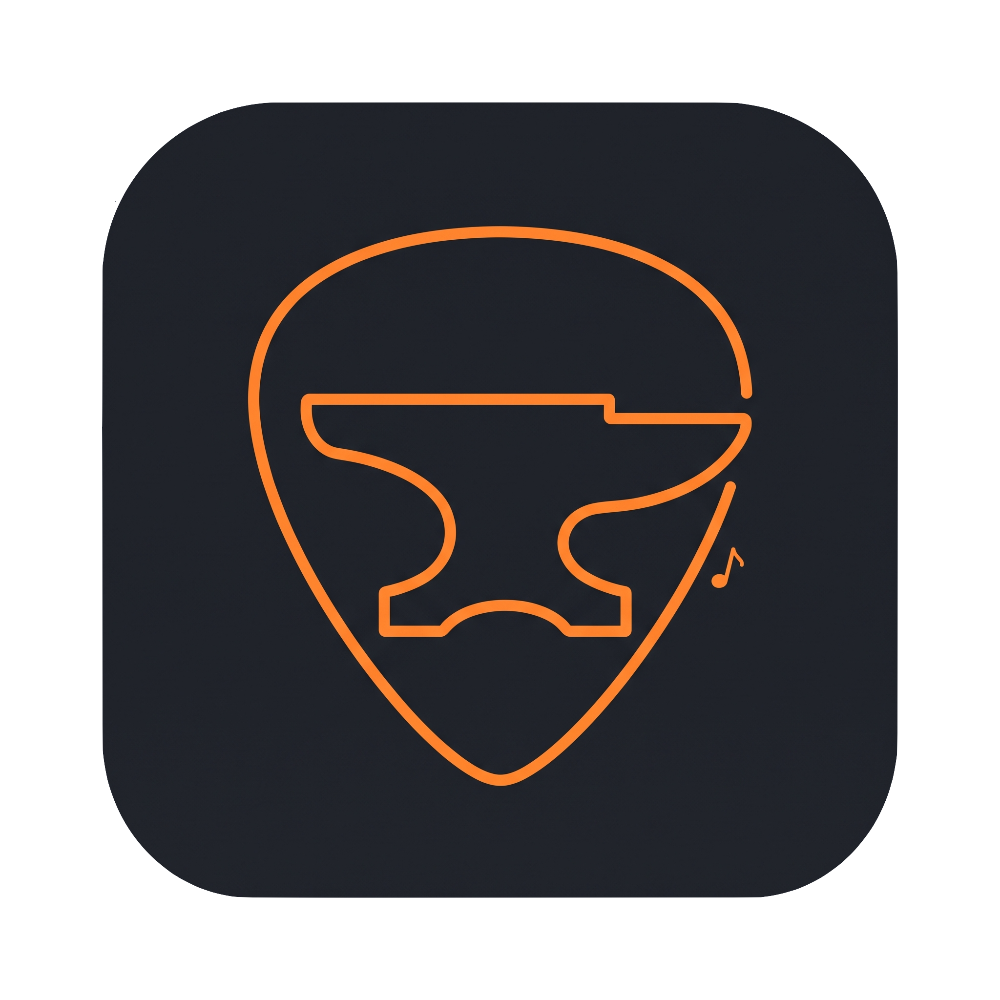
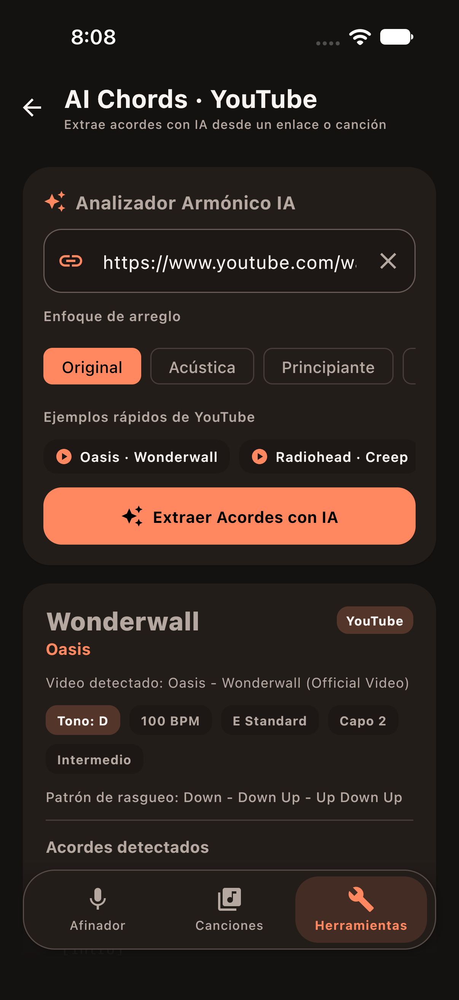
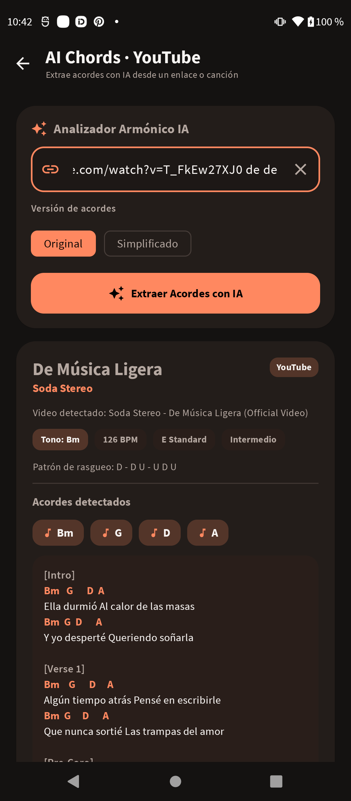
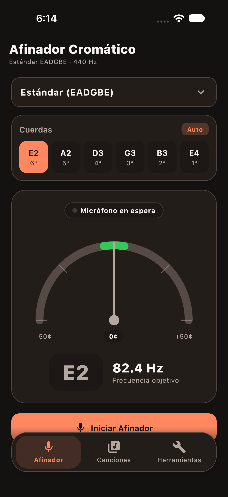
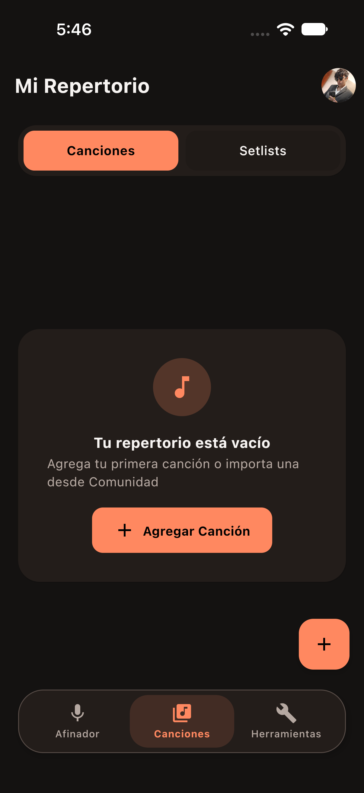
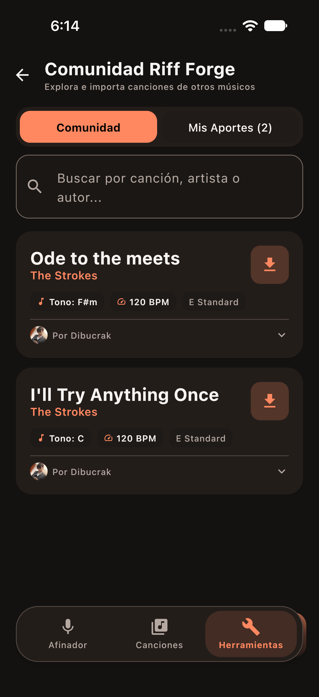

<div align="center">



# RiffForge

**Your all-in-one guitar & music companion** — AI YouTube chord extractor, chromatic tuner, smart metronome, music theory lab, ear training, and cloud-synced community repertoire for **iOS & Android**.

[](https://kotlinlang.org)
[](https://kotlinlang.org/lp/multiplatform/)
[](https://developer.android.com/jetpack/compose)
[](https://developer.apple.com/ios/)
[](https://developer.android.com)
[](https://developers.cloudflare.com/workers-ai/)

</div>

---

## 🎯 Problem & Target Audience

### The Problem
Guitarists and music students constantly jump across disconnected, ad-heavy, or paid apps just to practice daily: one app to tune their instrument, another for a metronome, web search tabs filled with pop-ups to figure out chords from a YouTube song, and local notes to track songs and setlists.

### Target Audience & Solution
**RiffForge** is built for **guitarists, self-taught musicians, band members, and music learners** who want a single, fast, distraction-free companion on **iOS** and **Android** with:
- Real-time tuning, rhythm/ear training, and visual theory tools.
- **AI Chords (YouTube → Chords)** powered by serverless LLM inference to inspect YouTube songs and save playable chord sheets straight into their repertoire.
- Offline-first song & setlist management backed by **Firebase Authentication** and **Cloud Firestore** community sharing.

---

## 🎸 Features

- **AI Chords (YouTube → Acordes)** — Paste any YouTube URL or song query, choose **`Original`** or **`Simplificado`** (automatic open-chord + optimal capo transposition), inspect key, BPM, capo, tuning, strumming pattern, over-lyric chords aligned above real lyrics, and save directly to **Mi Repertorio** with one-tap **Ver canción** / **Editar** actions.
- **Chromatic Tuner** — Real-time pitch detection (`440 Hz`) with string selector and multiple tunings (`Standard`, `Drop D`, `DADGAD`, etc.).
- **Smart Metronome** — BPM control (`40–240`), time signature accents (`2/4`, `3/4`, `4/4`, `6/8`), tap tempo, and synthesized sound profiles (`Madera / Classic`, `Mecánico`, `Suave`).
- **Chord Dictionary** — Interactive chord library with Canvas fretboard diagrams, fingerings, and synthesized audio playback.
- **Music Theory & Ear Training** — Circle of Fifths, Fretboard Scale Builder (frets `0–12`), Harmonic Progression Generator, Daily Learning, and interactive Ear Training quizzes.
- **Repertoire & Practice Mode** — Local + cloud-synced songs and setlists with live chord transposition, active wake-lock practice mode, custom song deletion, and American (`C, D, E`) or Latin (`Do, Re, Mi`) notation.
- **Moderated Community & Admin Panel (Firebase Firestore)** — Share songs to the Community after admin review, manage users/roles with safety confirmation timers, and display synced Google/custom profile avatars across profile, repertoire, community, and admin screens.
- **Authentication & Cloud Backup** — Email/password + native Google Sign-In, account linking, custom gallery profile photos (`PHPicker` on iOS, Photo Picker on Android), and cloud backup/restore.

---

## 🤖 AI Integration (`AI Chords · YouTube`)

RiffForge avoids bundling any third-party LLM API keys inside mobile binaries by routing requests through a serverless 2-stage pipeline on **Cloudflare Workers** (`cloudflare-worker/`):

1. **YouTube & Lyrics Resolution (Parallel Stage 1)**: Resolves official track/channel metadata via YouTube `oEmbed`, fetches real song lyrics via **LRCLIB**, and extracts verified studio harmony (`key`, `tuning`, `capo`, `bpm`, section progressions) using **Cloudflare Workers AI** (`@cf/google/gemma-4-26b-a4b-it`, with automatic fallback to `@cf/openai/gpt-oss-120b`).
2. **Lyric Alignment & Over-Lyric Formatting**: `@cf/meta/llama-3.3-70b-instruct-fp8-fast` aligns the verified chords to real song verses, then deterministic server post-processing converts the sheet into standard **chords-above-lyrics** layout wrapped cleanly for mobile screens. For **`Simplificado`** mode, a deterministic chord simplifier evaluates capo shifts (`0–7`) to minimize barre chords while keeping the true pitch.
3. **Notation, Persistence & Direct Editing**: Both native Android (`app/` via `OkHttp`) and KMP/iOS (`composeApp/` via `NSURLSession` / `HttpURLConnection`) transpose chords automatically (`Americano` / `Latino`), save into **Mi Repertorio**, and unlock immediate **Ver canción** and **Editar** buttons.

### How to Test AI Chords in the App
1. Open **RiffForge** and go to the **Herramientas** tab (bottom bar).
2. Under **Práctica & IA**, tap **AI Chords (YouTube)**.
3. Paste any YouTube URL (e.g., `https://www.youtube.com/watch?v=6hzrDeceEKc`) or `"Song - Artist"`, and choose **`Original`** or **`Simplificado`**.
4. Tap **Extraer Acordes con IA** — inspect the chords above the lyrics, tap **Guardar en Mi Repertorio**, and use **Ver canción** or **Editar** directly.

---

## 🏗️ Architecture & Tech Stack

RiffForge uses a **Kotlin Multiplatform (KMP)** architecture combining Clean Architecture + MVVM across native Android, shared Compose Multiplatform/iOS, and serverless edge AI:

| Module | Platform | Stack & Responsibilities |
|--------|----------|--------------------------|
| `app/` | Native Android | Clean Architecture + MVVM, Jetpack Compose, Hilt DI, Room DB, OkHttp, Credential Manager, Firebase Auth & Firestore |
| `composeApp/` | KMP (Android + iOS) | Shared Compose Multiplatform UI, Voyager (`ScreenModel`), Koin, `multiplatform-settings`, native `NSURLSession` & `AudioSynth` |
| `shared/` | KMP (`commonMain`) | Shared domain models, chord/scale catalogs, and harmonic transposer |
| `iosApp/` | Native iOS (Swift) | SwiftUI/UIKit host (`iOS 15.0+`), CocoaPods (`FirebaseAuth`, `FirebaseFirestore`), `PHPicker` profile photo bridge |
| `cloudflare-worker/` | Cloudflare Edge | Free-tier Cloudflare Worker orchestrating Gemma 4 26B (`@cf/google/gemma-4-26b-a4b-it`), LRCLIB lyrics, Llama 3.3 70B alignment, and over-lyric formatting |

### Design
Built with Material 3 and **Liquid Glass** floating navigation aesthetics, customizable dark/light presets, and seamless bilingual chord notation (`C D E` / `Do Re Mi`).

---

## 📸 Screenshots

| AI Chords (iOS) | AI Chords (Android) | Chromatic Tuner (iOS) | Repertoire & Profile Photo | Community & Synced Avatars |
|---|---|---|---|---|
|  |  |  |  |  |

---

## 🚀 Getting Started

### Prerequisites
- **Xcode 15+** (tested on **Xcode 26**), **iOS 15.0+ minimum deployment target**
- **CocoaPods** (`gem install cocoapods` or Homebrew `cocoapods`)
- **JDK 17–21** (tested with Microsoft OpenJDK 21) & **Kotlin 2.1+**
- **Android Studio Ladybug+** (for Android builds)
- **Firebase Config Files** (gitignored for security — place your own project files before building):
  - Android: `app/google-services.json`
  - iOS: `iosApp/RiffForge/GoogleService-Info.plist`

### Build & Run iOS (Xcode Workspace)
1. Compile the KMP frameworks for Simulator (`iosSimulatorArm64`) or physical device (`iosArm64`) and install Pods:
   ```bash
   ./gradlew :composeApp:linkReleaseFrameworkIosArm64 :shared:linkSharedReleaseFrameworkIosArm64
   cd iosApp && pod install
   ```
2. Open **`iosApp/RiffForge.xcworkspace`** in Xcode (never `.xcodeproj`), select your Team for signing if deploying to a physical iPhone, and run.

### Build Android (Signed Release APK)
```bash
./gradlew :app:assembleRelease :app:testDebugUnitTest
```
*(Optional release signing uses local gitignored `keystore.properties` + `keystore/riff-forge-release.jks`; debug builds run with `./gradlew :app:assembleDebug`.)*

### Cloudflare Worker (`cloudflare-worker/`)
The production endpoint `https://riff-forge-ai.riffforge-ai.workers.dev/api/ai-chords` is already live. To deploy your own instance:
```bash
cd cloudflare-worker && npx wrangler deploy
```

---

## 🎬 Demo & Showcase

- **GitHub Releases**: [`v1.2.0`](https://github.com/Dibucrak/Riff-Forge/releases/tag/v1.2.0) — downloadable signed Android APK (`RiffForge-v1.2.0-android.apk`) & iOS `arm64` package (`RiffForge-v1.2.0-ios.ipa`)
- **Video Demo (YouTube)**: *Pending upload (`https://youtu.be/...`)*
- **Vitrina Tecsup**: *Pending submission (`https://vitrina.xrlabs.lat/...`)*

---

## 📄 License

This project is licensed under the MIT License — see [LICENSE](LICENSE) for details.

## 👥 Contributors

- **Dibu (Joaquín Macedo)** — Creator and lead developer

---

<div align="center">

**RiffForge** — Forge your sound 🎵

</div>
