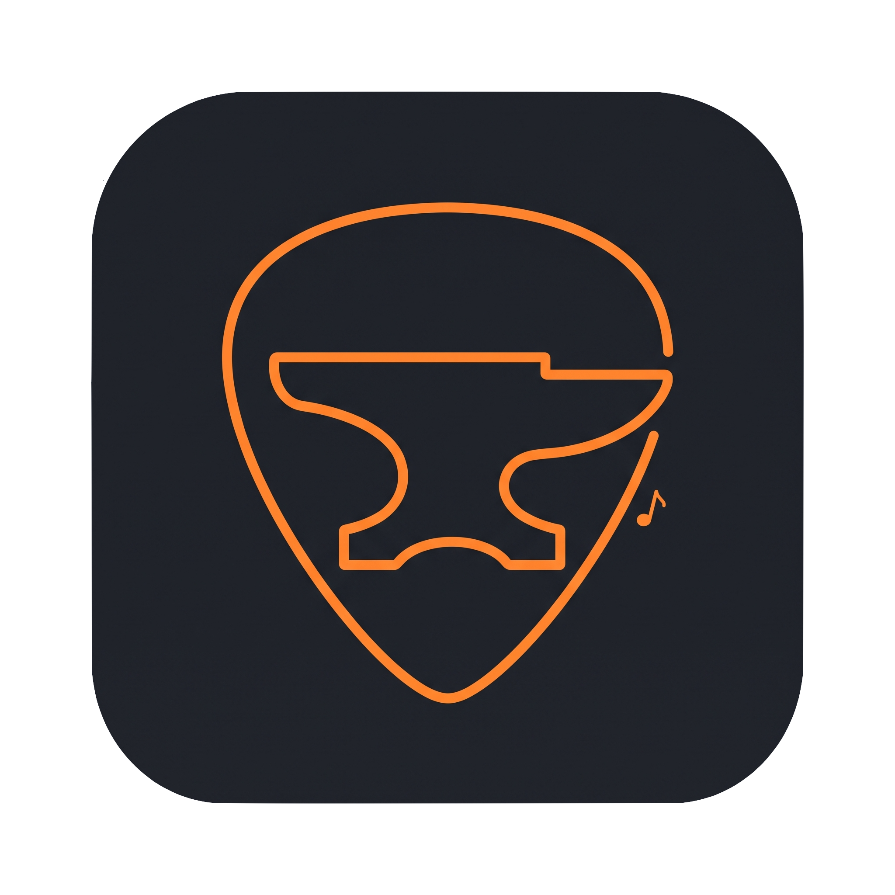

<div align="center">



# RiffForge

**Tu compañero musical todo en uno** — afinador, metrónomo, diccionario de acordes, teoría musical y más.

[](https://kotlinlang.org)
[](https://kotlinlang.org/lp/multiplatform/)
[](https://developer.android.com/jetpack/compose)
[]()

</div>

---

## 🎸 Características

- **Afinador** — Afiña tu instrumento con precisión
- **Metrónomo** — Mantén el ritmo con metrónomo configurable
- **Diccionario de acordes** — Biblioteca completa de acordes con diagramas
- **Teoría musical** — Círculo de quintas, escalas y progresiones armónicas
- **Repertorio** — Organiza tus canciones con transposición de acordes
- **Backup en la nube** — Guarda y restaura tu progreso desde la nube
- **Soporte en español** — Nomenclatura de notas en español o inglés

## 🏗️ Arquitectura

RiffForge es una app **Kotlin Multiplatform (KMP)** que comparte código entre Android e iOS:

| Módulo | Plataforma | Descripción |
|--------|-----------|-------------|
| `app/` | Android nativo | App principal con Firebase, Hilt y UI Compose |
| `composeApp/` | KMP (Android + iOS) | UI compartida vía Compose Multiplatform |
| `shared/` | KMP (common) | Lógica de negocio compartida (acordes, transposición) |
| `iosApp/` | iOS nativo | Contenedor SwiftUI que incrusta composeApp |

### Diseño

Todo el proyecto usa el lenguaje de diseño **Liquid Glass**, inspirado en Apple Vision Pro, con:
- Fondos neutros y un solo color de acento (naranja forja `#FF9F0A`)
- Componentes de cristal esmerilado
- Sombras neutras y texto adaptativo
- Soporte para modo claro y oscuro

## 🚀 Empezando

### Requisitos

- **JDK 17+**
- **Android Studio Ladybug+** (o IntelliJ IDEA con plugins de Android/Kotlin)
- **Xcode 15+** (para construir iOS)
- **Kotlin 2.1+**

### Construir Android

```bash
./gradlew :app:assembleDebug
```

### Construir iOS

Abre `iosApp/RiffForge.xcodeproj` en Xcode y ejecuta en simulador o dispositivo.

### Construir composeApp

```bash
./gradlew :composeApp:assembleDebug
```

## 📱 Capturas

<div align="center">

<!-- Agregar capturas de pantalla aquí -->

</div>

## 📄 Licencia

Este proyecto está bajo la licencia MIT — ver [LICENSE](LICENSE) para detalles.

## 👥 Contribuyentes

- **Dibu** — Creador y desarrollador principal

---

<div align="center">

**RiffForge** — Forja tu sonido 🎵

</div>
